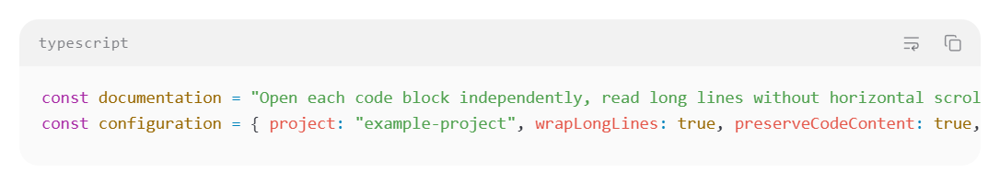
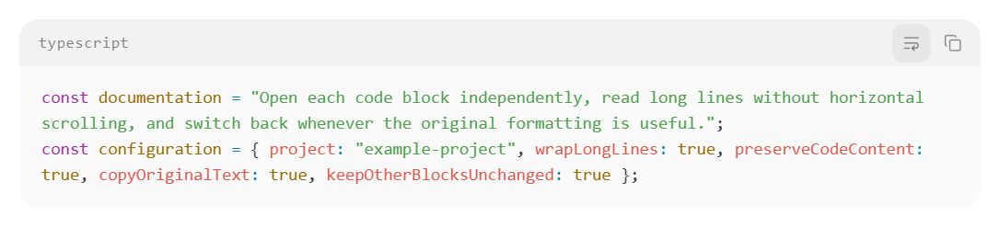
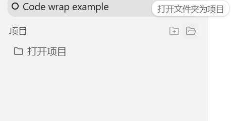
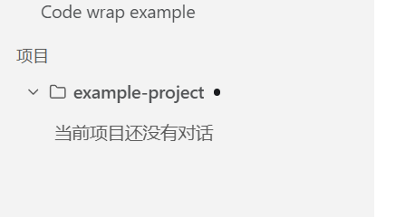

# Feature proposal screenshots

Screenshots of two local prototypes for discussion in upstream feature
requests. The images use synthetic conversations and an isolated example
project. They are cropped captures of the packaged Windows application.

## Per-code-block soft wrapping

Default horizontal scrolling:

The same block with soft wrapping enabled:

Implementation: [6eb93eb7b](https://github.com/ytton/PI-Desktop/commit/6eb93eb7b1e6429abc3bf2215931429b3b2eefda).

## Open a folder as a project

The sidebar action beside New Project:

The named project after selecting a folder:

Implementation: [dca33228a](https://github.com/ytton/PI-Desktop/commit/dca33228af5172c9e95dcbdf55b09ddfc98bedfa).

## Capture and validation context

- Application: PI-Desktop 0.21.0-beta.3, Windows x64.
- Base: `e219a3e4c0e4cc73ddacde78005987a85d5977d6`, with both prototype
  commits included in the local package.
- Code wrapping was enabled through the real code-block control. The first
  block wrapped while the second retained horizontal scrolling.
- The folder action used the real renderer, preload, IPC and Rust host.
  The native picker response was supplied at the Electron dialog boundary
  with an isolated fixture folder; no provider calls were made.
- These are proposal illustrations, not evidence that the prototypes are
  included in an upstream release or validated against current upstream main.
